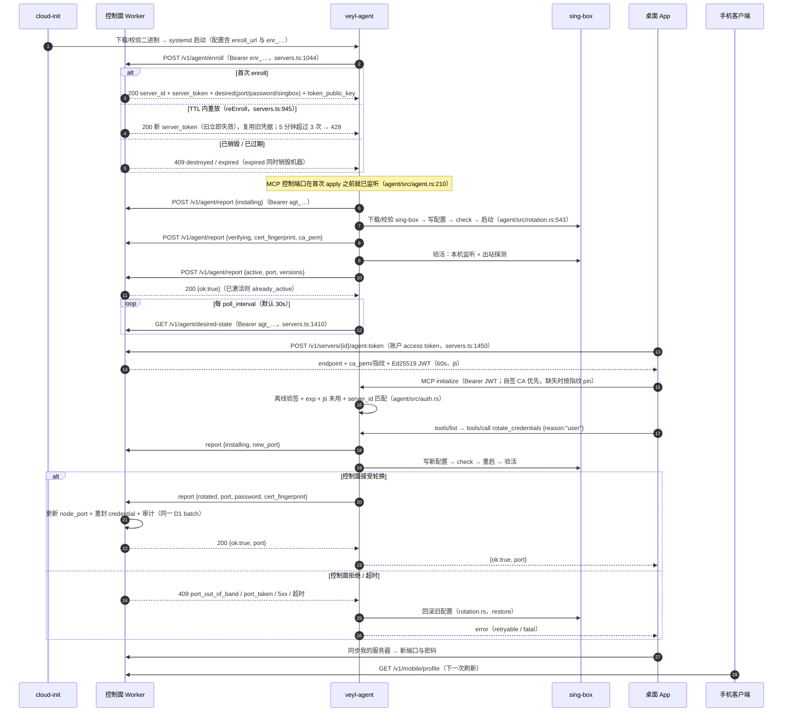
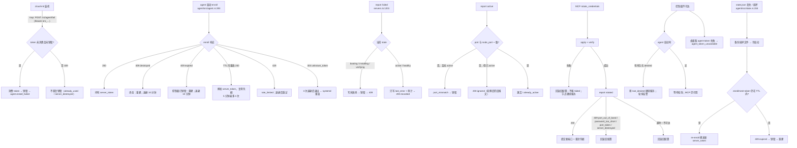

# 节点 agent 与 MCP 自救链路

> 日期：2026-11-21
> 状态：**方案待评审**。只出设计，不改代码。
> 上游：`node-rotation-and-sync.md`（问题清单）、`claurst-mcp-integration.md`（claurst 的 MCP 能力调研）、`shared-firewall.md`（端口带）
> 结论一句话：**节点上跑我们的 agent，它既是 sing-box 的安装者与管理者，也是一个只暴露 `rotate_credentials` 一个工具的远端 MCP server；桌面端用 claurst 自带的 MCP 客户端调用它，修复失败就引导重建。**

---

## 1. 适用范围

- **只解决端口级故障**：机器在线（ping 通）、服务端口从本地不可达（TCP 超时），但境外可连。
- **IP 级封锁不在范围**：整机 TCP 不可用一律销毁重建（已拍板）。
- 前提：共享防火墙使用固定端口带（`shared-firewall.md` §3.2），轮换端口不需要改 DO 规则。

## 2. 架构

```
桌面 App
  ├─ 界面按钮「智能修复」 / AI 工具调用（确认卡）
  └─ claurst MCP client（rmcp）──HTTPS/Streamable HTTP──┐
                                                        │
云服务器（root）                                          │
  ├─ veeyl-agent（我们的二进制，systemd）  ←──────────────┘
  │    ├─ MCP server，只暴露 rotate_credentials
  │    ├─ sing-box 的安装/升级/配置/重启
  │    └─ 出站轮询：登记、上报、拉取期望状态
  └─ sing-box（Shadowsocks 入站，端口在 30000–30999 内）
```

agent 是**机器的管理员**：cloud-init 只负责把它装上并启动，之后 sing-box 的安装与变更都由它完成。

## 3. 源码、构建与分发

- **源码位置**：仓库根目录新建 `agent/`，独立 Rust 项目（不并进 `src-tauri` 的 workspace，避免把 Tauri 依赖拖进来）。
- **构建脚本**：`scripts/agent/build-release.sh` 做本地校验（`cargo test --features dev` + host release 构建 + sha256）；`--tag` 推送 `agent-v<版本>` 触发 `.github/workflows/agent-release.yml`，在 CI 里构建 `linux amd64/arm64` 的 musl 静态二进制。产物是裸二进制 + `SHA256SUMS`。
- **分发**：与 sing-box 同一套逻辑——上传到 GitHub Release，控制面配置里钉死版本号与 sha256；cloud-init 只负责下载、校验、安装 agent。控制面目前只有一组 `AGENT_DOWNLOAD_URL` / `AGENT_SHA256`，先按 amd64；arm64 需要按架构再加一组（见 §12 遗留）。
- **升级**：v1 不做自更新。agent 版本由重建决定；控制面在下发期望状态时核对版本与 sha256，不一致就上报失败，而不是静默跑旧版本。

## 4. 安装

cloud-init 从「装 sing-box、写配置、起服务、上报三阶段」收缩为：

1. 下载 `veyl-agent`（版本与 sha256 写死在控制面下发/镜像里）
2. 写 systemd unit（root、开机自启、失败重启）
3. 把 enrollment token 交给它
4. 启动

agent 随后：

1. 用 token 换取「期望状态」：`server_id`、端口、密码、sing-box 版本与下载地址（sha256 固定）
2. 下载并校验 sing-box → 写配置 → `sing-box check` → 起 systemd 服务
3. 按 `installing / verifying / active` 三阶段上报（沿用现有控制面收上报的逻辑）

**端口和密码的真源因此从服务器搬到控制面**：agent 拉下来应用，而不是自己生成再回传。

## 5. 登记与发现

**契约新增四条控制面接口**（写进 `my-servers.md` §19.6，控制面接口版本随之升一档）：

| 接口 | 鉴权 | 用途 |
|---|---|---|
| `POST /v1/agent/enroll` | `Authorization: Bearer enr_…`（enrollment token，cloud-init 写进 agent 配置） | 领取期望状态与长期 `server_token`；**在 enrollment TTL 内、服务器未销毁时可重放**，每次换发新 `server_token` 并作废旧 token（§5.1） |
| `POST /v1/agent/fail` | `Authorization: Bearer enr_…`（同一个一次性 token） | cloud-init 装机失败时回传：消费 token 并销毁服务器，不留计费实例 |
| `POST /v1/agent/report` | `Authorization: Bearer agt_…`（`server_token`） | 上报阶段（`installing / verifying / active / failed / rotated`）、服务端口、agent 与 sing-box 版本；同时登记控制端口、TLS 指纹与自签 CA |
| `GET /v1/agent/desired-state` | `Authorization: Bearer agt_…` | 拉取最新期望状态（端口、密码、sing-box 版本与 sha256）；后续轮换与升级都走它 |
| `POST /v1/servers/{id}/agent-token` | 账户访问令牌（与服务器列表同一套） | 桌面端取这台节点的 agent 端点 + TLS 指纹 + 一次性 Ed25519 令牌 |

`/v1/agent/*` 的响应一律带 `Cache-Control: no-store`；除 enroll/fail 外，令牌与凭据都不进日志。

`POST /v1/agent/enroll` 响应示例：

```json
{
  "server_id": "srv_…",
  "server_token": "agt_…",
  "desired": {
    "port": 30412,
    "password": "<明文，仅此一次下发>",
    "control_port": 32100,
    "singbox": { "version": "1.14.4", "sha256": "…", "url": "https://…/sing-box-1.14.4-linux-amd64.tar.gz" }
  },
  "token_public_key": "{\"kty\":\"OKP\",\"crv\":\"Ed25519\",\"x\":\"…\"}"
}
```

- `singbox.url` 指向 sing-box 官方发布的 **tar.gz**；`sha256` 是该压缩包的摘要。版本与地址由控制面 env（`SING_BOX_VERSION` / `SING_BOX_SHA256` / `SING_BOX_DOWNLOAD_URL`）配置。
- `token_public_key` 是**字符串**形式的 Ed25519 公钥 JWK（只含 `kty` / `crv` / `x`），agent 用它离线验证桌面端的令牌，不需要再回调控制面。
- `server_token` 只在 enroll 响应里出现；控制面只存哈希（`servers.server_token_hash`）。
- **重放语义（2026-11-22 定）**：enrollment token 已消费、仍在 `enrollment_expires_at` 内、服务器未销毁时，再次 enroll 会换发新的 `server_token`（旧 token 立即失效）、按旧凭据重封（同一 host / 端口 / 密码，不重新生成），并写 `agent.re_enrolled` 审计；同一服务器 5 分钟内最多 3 次，超出 `429 rate_limited`。这是 agent 丢 `state.json` 或首次 enroll 响应丢失后的恢复路径。
- 已销毁返回 `409 destroyed`；已过期返回 `409 expired`（并销毁服务器）。这两个是终态，agent 应写明确日志并长退避，不要短时间内反复重试。
- 密码 32 位十六进制（16 字节随机），端口取 `servers.node_port`，host 取 `servers.ip`；三者封存进 `credentials`，也是 `desired-state` 的真源。
- `node_id` 在 enroll 时由控制面生成并写回 `servers.node_id`；`report active` 只沿用它，不再另外生成。

`POST /v1/agent/report` 请求体：`{ stage, port?, password?, error?, agent_version?, singbox_version?, control_port?, cert_fingerprint?, ca_pem? }`。

- 合法 `stage`：`installing` / `verifying` / `active` / `failed` / `rotated`；其它值返回 `400 invalid_stage`，不改状态。
- `installing` / `verifying` 只允许向前推进（乱序回 `200 {ok:true, ignored:true}`），与旧 enroll 一致。
- `active` 走激活语义：`node_id`（enroll 时的值）、订单 `ready`、服务器 `active`、at_ready 订单结算第 0 天。
  - **幂等**：机器已经是 `active` / `healthy` 时再报 `active`，直接返回 `200 {ok:true, already_active:true}`，不重复激活、不销毁；并发两次也只有一个真正激活，另一个按成功处理。
  - 机器还在进度阶段（booting/installing/verifying）而 `port` 与 `servers.node_port` 不一致：按 `port_mismatch` 销毁（配置真漂移了）。
  - 机器**已经 active** 而端口不一致：只可能是轮换后的旧报文竞态，返回 `200 {ok:true, ignored:true}`，**不销毁**。
- `failed` **只在装机阶段销毁**：当前状态为 `booting` / `installing` / `verifying` 时按阶段写失败码（`install_failed` / `verify_failed` / `service_inactive`）并销毁；已经是 `active` / `healthy` 的机器只写 `last_error` 与 `agent.report.failed` 审计，返回 `200 {ok:true, recorded:true}`，**不销毁**——否则一次期望状态配错（版本 / URL / sha）就会把在跑的付费机器批量销毁。`error` 原文截断 300 字后写入 `servers.last_error`。
- `rotated` 是**轮换结果的同步**，不是失败路径：
  - 请求：`{ stage: "rotated", port, password, cert_fingerprint? }`；
  - 校验：`port` 必须在 `30000-30999` 内、`password` 长度 ≥ 16、端口没有被同账户其它未销毁服务器占用（`servers(account_id, node_port)` 唯一索引兜底）；
  - 通过后：更新 `servers.node_port`，用 `CREDENTIAL_ENC_KEY` 重封 `{host, port, password, method}` 写回 `credentials`，写 `server.rotated` 审计（只记端口），返回 `200 {ok:true, port}`；
  - **任何情况都不销毁**；校验失败返回 `409` + `port_out_of_band` / `password_too_short` / `port_taken` / `server_destroyed`，由 agent 回滚到旧配置。
- 每次上报都刷新 `last_seen_at`，并登记 `agent_version` / `singbox_version` / `control_port` / `cert_fingerprint` / `ca_pem`（缺失字段保留上一次的值；`singbox_version` 传空串也保留原值）。成功上报会清空 `servers.last_error`，`failed` 才会重新写入。`ca_pem` 是 agent 自签 CA 的 PEM，桌面端优先用它建立信任。

`POST /v1/agent/fail` 由 cloud-init 的 `trap` 调用（请求体可为空）：只接受「enrollment token 未消费、服务器未销毁」的行；消费 token 后销毁服务器、关单并写 `agent.install_failed` 审计。已消费或已销毁一律 `409`。

`GET /v1/agent/desired-state` 响应：

```json
{
  "server_id": "srv_…",
  "desired": {
    "port": 30412,
    "password": "…",
    "control_port": 32100,
    "singbox": { "version": "1.14.4", "sha256": "…", "url": "https://…" }
  }
}
```

`POST /v1/servers/{id}/agent-token` 响应：

```json
{
  "endpoint": "https://203.0.113.10:32100/mcp",
  "cert_fingerprint": "AA:BB:…",
  "ca_pem": "-----BEGIN CERTIFICATE-----\n…",
  "token": "<Ed25519 JWT，claims { server_id, jti, exp }，60 秒>",
  "key_id": "agent-2026-11"
}
```

- `endpoint` 是**完整 URL**（含 agent MCP 的路径 `/mcp`）：客户端直接用，不要自行拼接路径或端口。
- `ca_pem` 是 agent 上报的自签 CA PEM（未登记时为 `null`）。桌面端**优先用 CA 建立信任**，缺失时才退回 `cert_fingerprint` 指纹 pin。

- 只有 `servers.state ∈ {active, healthy}` 且 agent 已登记 `ip` 与 `cert_fingerprint` 时才签发；否则 `409`（`not_ready` / `agent_not_registered`）。
- 令牌用**独立密钥** `AGENT_TOKEN_SIGNING_JWK` 签名（`key_id` 由 `AGENT_TOKEN_KEY_ID` 配置，不与 `CREDENTIAL_SIGNING_JWK` 共用）；`jti` 由 agent 侧记账保证一次性。

要点：

- 控制面原来的 enroll 是「服务器生成凭据、回传控制面封存」；改成「控制面生成凭据、下发给 agent」，凭据真源随之搬到控制面。
- `server_token` 每个服务器一把，可单独轮换；泄漏只影响一台机器。
- 桌面端不保存任何节点地址；调用前向控制面要「这台节点的 agent 端点 + 一次性令牌」。控制面不可达时，AI 与「智能修复」都不可用——这一点要在 UI 上明确，不是静默失败。

## 6. 鉴权

- 桌面端向控制面申请一张**短时效（60 秒）、一次性、Ed25519 签名**的令牌，内容是 `{server_id, jti, exp}`。
- 桌面端把它放进 `Authorization: Bearer`，调用 agent 的 MCP 端点。
- agent 内置控制面公钥，**离线验签**；同时检查 `jti` 未用过、`exp` 未过期、`server_id` 是自己的。
- agent 不持有任何长期密钥；控制面侧记录签发与使用（审计）。

## 7. 传输与 TLS

MCP 远端传输用 Streamable HTTP。节点没有域名、也拿不到 Let's Encrypt 证书，所以：

- **不需要购买证书**。公共 CA 签发要验证域名归属（HTTP-01 / DNS-01），裸 IP 拿不到；商业 CA 的 IP 证书按台计价、要逐年续期，不划算。方案用的是自签证书，成本为零。
- **每台节点自己生成一套 CA + leaf**，不是全局共用一张。这样攻破一台机器拿到的证书冒充不了另一台；代价是信任由我们自己管（控制面下发指纹/CA），不依赖公共 CA 背书。
- **推荐**：agent 首次启动生成自签证书，指纹随登记上报；桌面端按指纹 pin（等价于 TOFU + 固定）。控制面是唯一的指纹来源，桌面不信任任何未经控制面告知的证书。
- **已验证（2026-11-21）**：rmcp 1.8 的 `StreamableHttpClientTransport::with_client` 可以把自定义 `reqwest::Client` 注入进去，`add_root_certificate`（信任自定义 CA）与自建 rustls verifier（SHA-256 指纹 pin）都实测可用；四组对照见 `claurst-mcp-integration.md` §4.1 与 `scripts/dev/tls-probe/`。
  - 但 **claurst 的 `McpClient` 用不了**：`connect_http` 写死 `from_config`，`McpServerConfig` 没有 TLS 字段，自签证书连不上，且不改子模块无法注入。
  - 因此桌面端**直连 rmcp**（自己建 reqwest client），不复用 `claurst_mcp::McpClient`。rmcp 1.8 依赖 reqwest 0.13，Veyl 侧加依赖时注意版本一致。
  - 首版建议信任**自签 CA 文件**而不是整张证书指纹：轮换 leaf 证书时不用改桌面端信任；CA 轮换才需要控制面重新下发。
- 明文 HTTP + 令牌**不接受**：令牌是 root 级操作的凭据，必须走 TLS；`danger_accept_invalid_certs` 同样不接受（等于放弃校验）。

## 8. 工具

只暴露一个：

| 名称 | 参数 | 行为 |
|---|---|---|
| `rotate_credentials` | `{ reason?: "blocked" \| "user" }` | 生成新密码与端口带内的新端口 → 写配置 → `sing-box check` → 重启 → 验活（本机监听 + 出站连通）→ 成功则把新值上报控制面并返回 `{ok:true, port}` |

- 返回体**不含密码**；密码只经 agent → 控制面的鉴权通道写回，桌面端靠同步拿新值。
- 失败分两类：`retryable`（重启失败可再试一次）与 `fatal`（配置写坏、sing-box 起不来）——后者 UI 直接引导重建。
- 不做任意命令执行、不做参数化的路径/端口选择（端口由 agent 在带内选，密码由 agent 生成）。

## 9. 端到端流程

```
用户点「智能修复」（或 AI 调用工具 → 确认卡）
  → 桌面请求控制面：签发一次性令牌 + 返回 agent 端点/指纹
  → 桌面 MCP 调用 rotate_credentials
  → agent 换端口+密码、重启、验活
  → agent 上报新值；控制面重封 credential（Worker 自己解封→重封，无需人工 key）
  → 桌面下次同步拿到新端口与密码
  → 手机端订阅刷新同样生效
```

失败：agent 返回 fatal，或调用超时 → UI 显示「自动修复失败，需要重建节点」并就地给重建入口。

图形版如下。两张图都以 HEAD 的实现为准，边上标注对应接口或文件；HTTP 错误码取自 `servers.ts` 的实际返回。

### 9.1 时序图：从 cloud-init 到手机刷新



### 9.2 失败分支图



## 10. 桌面端接入（路线 B，已由调研确认）

- 不改 `mcp_manager`（会话工具列表构造时冻结，改它会侵入主流程）。
- 新增一个原生工具 `NodeRotateCredentials`：内部**直接用 rmcp 的 client**（`with_client` + 自定义 reqwest client，信任自签 CA 或按指纹 pin）连接节点 MCP 端点，完成 `initialize → tools/list → tools/call`。不能用 `claurst_mcp::McpClient`（它写死 `from_config`，见 §6）。
- 复用现有工具的确认卡、超时、审计；AI 与界面按钮走同一个执行入口。
- 证据与备选路线见 `claurst-mcp-integration.md`。

## 11. 安全边界

- **绑定面约束**：agent 只允许绑定两个端口——控制端口 `32100` 与 sing-box 的 SS 端口。机器无 root 密码、无 SSH，能起进程的只有 agent，所以这条由代码保证，不依赖运维纪律。
- **带外入口**：cloud-init 会停用并禁用 SSH；机器出问题时**云厂商 console 仍是唯一的带外入口**。
- 控制端口暴露在公网：只接受带有效一次性令牌的 MCP 请求；`initialize` 之前即验令牌。
- 工具集只有一个，不接受自由参数。
- 令牌一次性 + 60 秒过期；同一节点并发修复只允许一个在跑。
- 所有调用记审计（谁、何时、结果）；密码与令牌不进日志。
- 控制端口不做防封（已拍板）：流量近零，被封即重建。

## 12. 已定决策

2026-11-21 产品负责人逐条拍板，全部按建议执行：

| # | 问题 | 决定 |
|---|---|---|
| 1 | TLS 是否可行 | **已验证**：rmcp 1.8 `with_client` 可注入自定义 reqwest client，加根证书与指纹 pin 均可用；claurst 的 `McpClient` 用不了，桌面端直连 rmcp（§7 / `claurst-mcp-integration.md` §4.1） |
| 2 | agent 用什么写 | **Rust 静态二进制（musl）**，独立 `agent/` 项目，systemd 管理 |
| 3 | 自更新第一版做不做 | **不做**：版本由重建决定；控制面下发期望状态时核对版本与 sha256，不一致即失败 |
| 4 | 一次性令牌的签名密钥 | **单独一把**，不共用 `CREDENTIAL_SIGNING_JWK`，便于独立轮换 |
| 5 | 修复失败的判定口径 | 超时按 retryable **重试一次**；第二次失败、`sing-box check` 失败、进程起不来 → **fatal**，UI 引导重建 |
| 6 | 存量机器 | **不迁移**：直接销毁，新机器才带 agent |
| 7 | CA 轮换怎么下发 | v1 只做「登记时下发 CA/指纹」；轮换 = agent 重新生成证书并重新登记，控制面更新记录 |

遗留（不阻塞开工，实施时补齐）：

- **已定**：GitHub Release，tag `agent-v<版本>`，资产 `veyl-agent-linux-{amd64,arm64}` + `SHA256SUMS`，发布物是裸二进制（`.github/workflows/agent-release.yml`）。
- **arm64 待补配置**：控制面目前只有一组 `AGENT_DOWNLOAD_URL` / `AGENT_SHA256`，先按 amd64；要支持 arm64 需要按架构再加一组配置。
- **已定（2026-11-22）**：`server_token` 在每次 enroll（含 TTL 内的重放换发）时重签，旧值立即失效；节点被销毁即作废。
- **已定（2026-11-22）**：`agent/` 自 `4173443` 起经过状态机、安全、可观测性三次评审，必修与应修项已按 §5 / §7 落地；遗留项（并发修复串行化、控制端口限流、arm64 第二组配置）见 `docs/status.md`。
- 期望状态里是否携带多套端口候选（本期不需要，端口由 agent 轮换时自己选）。

## 13. 验收

1. 新建一台机器：cloud-init 只装 agent；agent 完成 sing-box 安装并上报 active。
2. 断开 sing-box 服务后点「智能修复」：能重启恢复。
3. 模拟端口被封（改防火墙踢掉该端口后）：点修复 → 端口更换 → 桌面同步 → 手机刷新 → 两端恢复可用。
4. 伪造令牌/过期令牌/重放令牌：agent 拒绝，且不改变任何配置。
5. 修复失败（把 sing-box 二进制删掉）→ UI 提示重建。
